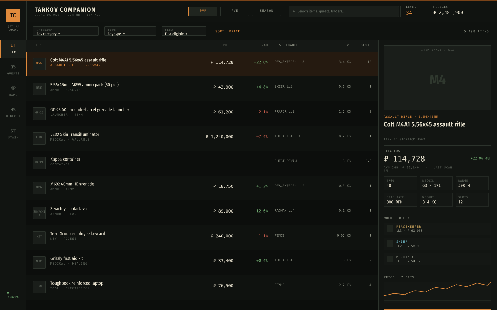
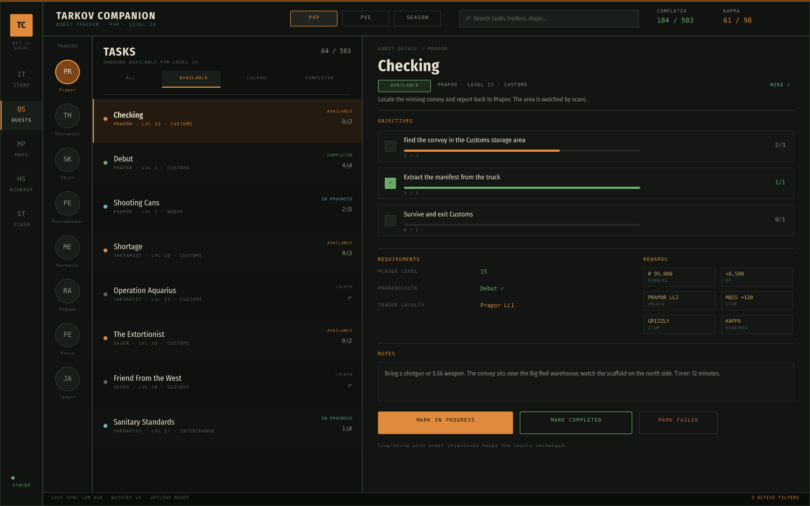
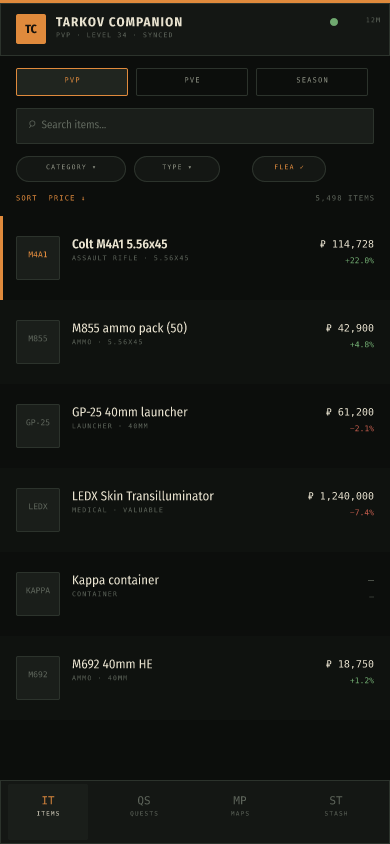

# Tarkov Companion

[](https://github.com/Tayuha/tarkov-companion/actions/workflows/ci.yml)
[](https://github.com/Tayuha/tarkov-companion/actions/workflows/data-sync.yml)

An open-source, local-first companion for **Escape from Tarkov**. Browse the item catalog, inspect
prices, and track quest progress on your own machine — offline after the first data sync, with no account
and no telemetry.

## Status

**Early Linux preview.** The Linux client implements first-run data sync, the item catalog and item
detail, the quest list and interactive quest detail, local profiles with JSON export/import, background
data-update checks, persisted window geometry, single-instance focusing, and an About screen. It packages
as an AppImage (optional `.deb`) and is not yet tagged or published. The remaining release gate is tracked
in [`docs/verification.md`](docs/verification.md); the backlog is in
[`openspec/changes/bootstrap-tarkov-companion/tasks.md`](openspec/changes/bootstrap-tarkov-companion/tasks.md).

Known limitations in this preview:

- Item artwork is not yet wired into the shell. The disk-backed image cache is implemented and tested, but
  catalog and detail screens currently render the placeholder. No `assets.tarkov.dev` request is made.
- The database recovery screen opens read-only and keeps the damaged file, but it does not yet offer an
  export or restore action.
- Windows and Android are buildable from the same `app/` tree but are not packaged or supported releases.
- Release artifacts are unsigned; `SHA256SUMS` is published for integrity checking.

## Screenshots

Preview renders from [`design/preview/`](design/preview/), not captures of a running release. The live
layout follows the same design system.

| Items | Quests |
|---|---|
|  |  |

| Narrow / mobile layout |
|---|
|  |

## Features

Implemented in the Linux preview:

- **Item catalog** — local search, category and trader filters, sorting, and a detail view with
  type-specific stats, trader and flea prices, price history, and quest use.
- **Quest tracker** — quest list, Catalog/Available views, requirements and rewards, per-objective
  progress, and completed/locked/available state derived from the active profile.
- **Local profiles** — one profile per game mode, activation, reset, deletion, and versioned JSON
  export/import with a non-destructive merge default.
- **Offline-first data** — seven versioned datasets are verified by SHA-256 and ingested into SQLite; all
  screens read the local database and keep working when the network is unavailable.
- **Background updates** — scheduled or manual data-update checks with a non-blocking status strip, last
  outcome, and retry. No silent self-updater.
- **Desktop shell** — persisted window geometry with display clamping, single-instance focusing on Linux,
  deep links to items and quests, and a navigation rail or narrow bottom bar.
- **About and attribution** — app version, bundle version and age, dataset counts, MIT licence, tarkov.dev
  attribution, and the trademark notice.

Not in v0.1: interactive maps, hideout/craft calculators, barter-profit planning, stash OCR, cloud sync,
and accounts.

## Architecture

```
json.tarkov.dev  --(scheduled GitHub Action)-->  normalized JSONL.zst bundles
                                                        |
                                                  GitHub Releases
                                                        |
                                            manifest + changed datasets
                                                        |
                                                        v
                                   Flutter app (Linux first; Windows/Android later)
                                       drift/SQLite = single read path
```

The installed app never calls the upstream API and never downloads a prebuilt database. A small TypeScript
pipeline validates and normalizes upstream JSON into versioned bundles; the app verifies each dataset by
SHA-256 and ingests it transactionally into its own schema. See
[`openspec/changes/bootstrap-tarkov-companion/design.md`](openspec/changes/bootstrap-tarkov-companion/design.md)
for the full rationale.

## Repository layout

| Path             | Purpose                                                                                      |
| ---------------- | -------------------------------------------------------------------------------------------- |
| `app/`           | Flutter client (Linux target at launch)                                                      |
| `pipeline/`      | Node/TypeScript data pipeline and bundle publisher                                           |
| `test/fixtures/` | Trimmed upstream fixtures used by tests                                                      |
| `docs/`          | Data contract, sync protocol, schema, privacy, release process, verification, and roadmap    |
| `openspec/`      | Specifications, design, and implementation plan                                              |
| `scripts/`       | Packaging, formatting, network-audit, and offline-verification helpers                       |

## Build from source

### Linux (first release target)

Prerequisites:

- Flutter **3.50.1** stable and Dart 3.14 (the project constraint is `sdk: ^3.14.0`);
- Git and a Linux desktop toolchain: `cmake`, `ninja`, `clang`/`gcc`, `pkg-config`, GTK 3 headers;
- Node.js **24+** only if you are building the data pipeline;
- `curl` or `wget` and `dpkg-deb` only for packaging (`dpkg-deb` is optional).

On Debian/Ubuntu:

```bash
sudo apt-get install -y build-essential clang cmake ninja-build pkg-config \
  libgtk-3-dev liblzma-dev curl
```

Clone and run the client:

```bash
git clone https://github.com/Tayuha/tarkov-companion.git
cd tarkov-companion/app
flutter pub get
flutter run -d linux
```

The first run needs network access to fetch the published data bundle from GitHub Releases. Once the sync
finishes, the catalog, quests, profiles, and progress work offline. The data root is
`${XDG_DATA_HOME:-$HOME/.local/share}/tarkov_companion`.

Build and run the release bundle:

```bash
cd ..                       # repository root
bash scripts/package-linux.sh
chmod +x dist/TarkovCompanion-0.1.0-x86_64.AppImage
./dist/TarkovCompanion-0.1.0-x86_64.AppImage
```

The script writes the AppImage, an optional `.deb` when `dpkg-deb` is present, and `dist/SHA256SUMS`. See
[`docs/linux-package.md`](docs/linux-package.md) for checksum verification and the manual approval
checklist, and [`docs/release.md`](docs/release.md) for the release workflow. Hosts without FUSE can run
the AppImage with `--appimage-extract-and-run`.

### Data pipeline (optional for app development)

The client downloads published data; you only need the pipeline when changing bundle contents. It runs
offline against committed fixtures:

```bash
cd pipeline
npm ci
npm test
npm run build -- --fixtures ../test/fixtures --out ../dist
```

### Windows and Android (unpackaged)

The platform folders are checked in and the Windows debug build is CI-checked, but neither target is
packaged or supported for the preview release:

```bash
cd app
flutter build windows --debug    # Windows host
flutter build apk --debug        # Android SDK installed
```

Release packaging for these targets stays deferred until the Linux gate passes. See
[`docs/linux-package.md`](docs/linux-package.md).

## Data and attribution

Game data comes from the community-run [tarkov.dev](https://tarkov.dev) project via its public API. The
pipeline publishes normalized derivative data; the installed app consumes only those GitHub release
assets. Item artwork, once the cache is wired in, is fetched from `assets.tarkov.dev` and cached locally.

This project is not affiliated with, endorsed by, sponsored by, or approved by Battlestate Games.
Escape from Tarkov and related marks are the property of Battlestate Games Limited and are used only for
identification. No official game art, audio, or other game assets are bundled. See [`NOTICE`](NOTICE).

## Privacy and security

No telemetry, analytics, crash reporting, accounts, cloud sync, or advertising. Network access is restricted
to four documented hosts: the GitHub release manifest and asset CDNs, and the tarkov.dev image host. The
client enforces the list before every request and on every redirect. Update checks are **data** checks;
there is no silent app updater.

Progress stays in the local SQLite database and in files you explicitly export. The full host allowlist,
rules, request payloads, and TLS behaviour are in [`docs/network.md`](docs/network.md). The threat model and
data-at-rest notes are in [`docs/security.md`](docs/security.md). Report vulnerabilities privately as
described in [`SECURITY.md`](SECURITY.md).

## Verification

Run the static network audit and the offline preflight before a release:

```bash
bash scripts/audit-network.sh
bash scripts/verify-offline.sh
```

The release gate checklists — offline behaviour, recovery from a corrupt database, captured-request review,
and this README walkthrough — are in [`docs/verification.md`](docs/verification.md). They are manual by
design; do not mark them complete without running them on a clean Linux environment.

Application tests:

```bash
cd app
flutter analyze
flutter test
```

## Contributing

Read [`CONTRIBUTING.md`](CONTRIBUTING.md) and [`CODE_OF_CONDUCT.md`](CODE_OF_CONDUCT.md). Planning artifacts
are managed with [OpenSpec](https://github.com/Fission-AI/OpenSpec):

```bash
openspec list --specs
openspec show bootstrap-tarkov-companion
openspec validate bootstrap-tarkov-companion --strict
```

Before opening a pull request, check formatting without rewriting unrelated files:

```bash
bash scripts/check-format.sh
```

The opt-in check covers `dart format` (80 columns) and Prettier for the release/CI docs. `--all` reports
legacy formatting drift. Conventional Commits are required; keep one logical change per pull request and
include the verification you ran.

## License

[MIT](LICENSE) © Tarkov Companion contributors.
